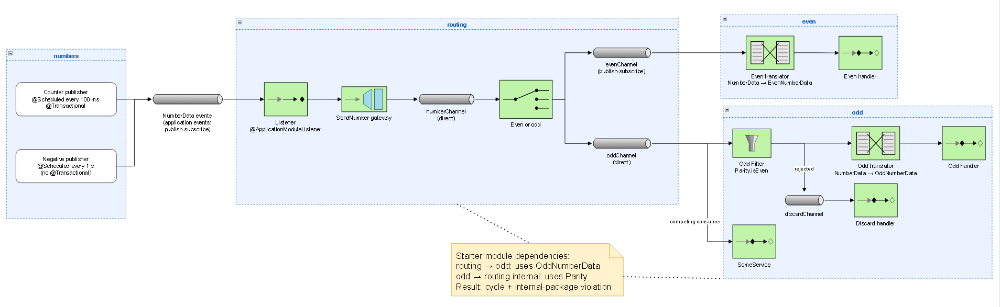

# Lab 5 Modules & Application Events -- Project Report

## EIP diagram (before)

[What the starter actually does, as drawn. Not what it should do.]

## What I specified

[How counter, negative, even and odd numbers must flow, which module may depend on which, and each difference between your diagram and `docs/EIP.png`, decided *before* generating or pasting code. How you would know each one is fixed.]

## What I changed

[Files and behaviour, one change per difference. Not a restatement of the starter README.]

## Technical decisions

[Why each change matches the target pattern or module rule (channel kind, router, module dependencies, transactions), and what you rejected.]

## How I verified

[The run against Manual verification in the guide, `./gradlew check` with `@Disabled` removed, which test failed first, what you fixed. You remain accountable for correctness.]

## AI disclosure

Fill **either** the list **or** the no-AI line.

- **Tools / skills:** …
- **Purpose:** …
- **Representative prompts:** … (or appendix)
- **Affected files/sections:** …
- **Validation steps:** …
- **Citations:** … (external snippets you adapted)
- **Human-reviewed:** what you checked, changed, or rejected

Or: **No AI assistance** was used for this lab.
