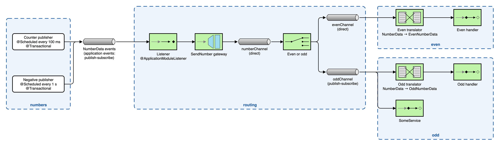
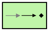
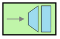
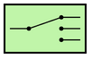
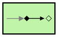

Fifth lab of 2026--2027. Command line is enough; **VS Code**, **IntelliJ IDEA**, **Eclipse**, or **GitHub Codespaces** are fine. You need **Java 25 LTS** (same pin as the group project).

**Estimated time**: 2 hours.

## Requirements

- [Kotlin 2.4.0](https://kotlinlang.org/) on **Java 25 LTS**. Do not downgrade the toolchain.
- [Gradle 9.6.0](https://gradle.org/) via the wrapper (`./gradlew`).
- [Spring Boot 4.1.0](https://docs.spring.io/spring-boot/) (Spring Framework 7) with `spring-boot-starter-integration` ([Spring Integration](https://docs.spring.io/spring-integration/reference/) and its [Kotlin DSL](https://docs.spring.io/spring-integration/reference/kotlin-dsl.html)).
- [Spring Modulith 2.1.2](https://docs.spring.io/spring-modulith/reference/) (`spring-modulith-starter-core`, `spring-modulith-starter-jdbc`), with an in-memory H2 database for its event publication registry. Nothing to install: the build brings it.
- [Ktlint](https://pinterest.github.io/ktlint/) on the build.

## Git and clone

1. Install [git](https://git-scm.com/).
2. GitHub education account: real name, university email.
3. Configure Git:

   ```bash
   git config --global user.name "Your Real Name"
   git config --global user.email "your_nip@unizar.es"
   ```

4. Authenticate with GitHub so you can clone this starter if Git asks. HTTPS is enough: [`gh auth login`](https://docs.github.com/en/github-cli/github-cli/quickstart) or Git Credential Manager. Do not use an account password. [Set up Git](https://docs.github.com/en/get-started/git-basics/set-up-git).

```bash
git clone \
  https://github.com/UNIZAR-30246-WebEngineering/lab5-soa.git
cd lab5-soa
./gradlew check
./gradlew bootRun
```

`./gradlew check` **passes** on the starter: `IntegrationFlowTests` and `ModularityTests` are `@Disabled`, so that green run is not your submission. After you remove `@Disabled`, the tests fail until the modules and flows match the target. `./gradlew bootRun` starts the application and logs every event and message; stop it with `Ctrl+C`.

### Codespaces (optional)

You can do the lab in [GitHub Codespaces](https://docs.github.com/en/codespaces) instead of a local JDK. The app opens no port; read its output in the terminal.

You cannot push to the course repository. If you need a remote of your own (Codespaces persistence), **fork** first and open the Codespace from that fork. A fork is not a submission: delivery is the Moodle zip only.

## Objective

The starter in `src/main/kotlin/soa/` is a Spring Modulith application with four modules. The `numbers` module publishes application events; the `routing` module turns them into messages for a Spring Integration flow; the `even` and `odd` modules handle the result. Both the modules and the flow are wired wrong. The target is this diagram (`docs/EIP.png`; in the PDF it has its own landscape page):

::: {.content-visible unless-format="pdf"}

:::

::: {.content-visible when-format="pdf"}
```{=latex}
\begin{landscape}
```

{width=100%}

```{=latex}
\end{landscape}
```
:::

You draw what the starter **actually** does, its flow and its module boundaries, then change the code until it behaves like the target and its modules pass Spring Modulith's verification. In **REPORT.md**, explain each difference between your diagram and the target, and which change removes it.

### Oral defence (all students)

An oral defence is **possible for everyone**, not only for the bonus. The teacher may ask you to explain this lab in person.

You are expected to **know** the submission and to **justify all decisions** in it: what you specified, what you changed, what you rejected, how you verified it, and any AI use. If you cannot explain a choice, you do not own it.

## Modules and application events

[Spring Modulith](https://docs.spring.io/spring-modulith/reference/fundamentals.html) treats each direct sub-package of the application's package as an **application module**: here `soa.numbers`, `soa.routing`, `soa.even` and `soa.odd`. A module's base package is its public API; its sub-packages, such as `soa.routing.internal`, are internal, and other modules must not use them. Modules must not depend on each other in a cycle. `ApplicationModules.of(…).verify()` checks both rules ([Verification](https://docs.spring.io/spring-modulith/reference/verification.html)).

Modules talk through [application events](https://docs.spring.io/spring-modulith/reference/events.html) instead of calling each other:

- The `numbers` module publishes a `NumberData` event with `publishEvent(…)` on Spring's `ApplicationEventPublisher`.
- The `routing` module receives it in an `@ApplicationModuleListener` method. That listener runs **after the publishing transaction commits**, asynchronously and in its own transaction. An event published outside a transaction never reaches it.
- Spring Modulith records each delivery in its [event publication registry](https://docs.spring.io/spring-modulith/reference/events.html#publication-registry), here an in-memory H2 database, so an incomplete delivery can be found and resubmitted.

`ModularityTests` also writes the module diagram with Spring Modulith's [Documenter](https://docs.spring.io/spring-modulith/reference/documentation.html) to `build/spring-modulith-docs/components.puml`.

## Enterprise Integration Patterns

[Enterprise Integration Patterns (EIP)](https://www.enterpriseintegrationpatterns.com/patterns/messaging/) is a catalogue of patterns for message-driven systems, with a common vocabulary and diagram notation. Spring Integration implements them.

Every arrow in a diagram carries a [Message](https://www.enterpriseintegrationpatterns.com/patterns/messaging/Message.html): a payload (here a `NumberData`) plus headers ([Spring `Message`](https://docs.spring.io/spring-integration/reference/message.html)). Components never call each other; they exchange messages through [Message Channels](https://www.enterpriseintegrationpatterns.com/patterns/messaging/MessageChannel.html).

How to read the diagrams (`docs/EIP.png` and the one you draw): messages flow left to right, and each channel is entered from the left and exited on the right. Every channel is drawn as a pipe, and its label says which kind it is: point-to-point (direct) or publish-subscribe. Dashed boxes are modules, and plain boxes are application code. The pipe between `numbers` and `routing` stands for Spring's application events. In a diagram, the words under each icon name the code element.

| EIP pattern | What it does | Spring Integration code |
| ---------- | ------------- | ------------------- |
| <br>[Event-Driven Consumer](https://www.enterpriseintegrationpatterns.com/patterns/messaging/EventDrivenConsumer.html) | Is called as soon as a message arrives, without asking for it | An `@ApplicationModuleListener` method ([Spring Modulith events](https://docs.spring.io/spring-modulith/reference/events.html)) |
| <br>[Messaging Gateway](https://www.enterpriseintegrationpatterns.com/patterns/messaging/MessagingGateway.html) | Lets ordinary code send a message by calling a method | A `@MessagingGateway` interface whose `@Gateway` method names the request channel ([Gateway](https://docs.spring.io/spring-integration/reference/gateway.html)) |
| <br>[Point-to-Point Channel](https://www.enterpriseintegrationpatterns.com/patterns/messaging/PointToPointChannel.html) | Each message goes to exactly one subscriber; several subscribers take turns | A channel name used in a flow, such as `channel("…")` or `integrationFlow("…")`, that no bean declares: Spring creates a `DirectChannel` (`MessageChannels.direct()` declares one explicitly) ([Channels](https://docs.spring.io/spring-integration/reference/channel.html)) |
| <br>[Publish-Subscribe Channel](https://www.enterpriseintegrationpatterns.com/patterns/messaging/PublishSubscribeChannel.html) | Each message goes to every subscriber | `publishSubscribe()` from `MessageChannels` ([Channels](https://docs.spring.io/spring-integration/reference/channel.html)). Spring's application events behave the same way: every listener gets each event |
| <br>[Content-Based Router](https://www.enterpriseintegrationpatterns.com/patterns/messaging/ContentBasedRouter.html) | Sends each message to one channel chosen from its content | `route { … }` returning a channel name ([Router](https://docs.spring.io/spring-integration/reference/router.html)) |
| <br>[Message Filter](https://www.enterpriseintegrationpatterns.com/patterns/messaging/Filter.html) | Passes the messages that meet a condition; drops the rest, or sends them to its discard channel. Only in the starter | `filter { … }` returning a boolean ([Filter](https://docs.spring.io/spring-integration/reference/filter.html)) |
| <br>[Message Translator](https://www.enterpriseintegrationpatterns.com/patterns/messaging/MessageTranslator.html) | Turns a message into another format | `transform { … }` ([Transformer](https://docs.spring.io/spring-integration/reference/transformer.html)) |
| <br>[Service Activator](https://www.enterpriseintegrationpatterns.com/patterns/messaging/MessagingAdapter.html) | Calls application code with each message it receives | `handle { … }`, or a `@ServiceActivator` method ([Service Activator](https://docs.spring.io/spring-integration/reference/service-activator.html)) |

More examples: [Spring Integration Samples](https://github.com/spring-projects/spring-integration-samples).

Icons and pattern names: [Enterprise Integration Patterns](https://www.enterpriseintegrationpatterns.com/patterns/messaging/), Gregor Hohpe and Bobby Woolf, used under [CC BY 4.0](https://creativecommons.org/licenses/by/4.0/). The icons in this guide and in `docs/EIP.png` are drawn with the draw.io EIP shapes.

## What the starter does

- `numbers`: `NumberSources` publishes a `NumberData` event for a counter every 100 ms, and for a negative random number every second. **Compare the annotations of the two methods.**
- `routing`: `NumberEvents` listens with `@ApplicationModuleListener` and hands each event to the `SendNumber` gateway, which sends it to `numberChannel`. `RoutingFlows` declares `evenChannel` as publish-subscribe and routes by parity. **How does the router decide what is odd?**
- `even`: `EvenFlows` translates `NumberData` to `EvenNumberData` and handles it.
- `odd`: `OddFlows` reads `oddChannel` through a filter (**read the condition, and where `Parity` comes from**), translates and handles. `SomeService` is a `@ServiceActivator` on `oddChannel` too. A discard flow waits on `discardChannel`.

A run of the starter. Listeners run on `event-N` threads, so lines about different numbers can interleave:

```
[scheduling-1 ] 📥 Source generated number: 0
[scheduling-1 ] 🚀 Source generated negative number: -84
[event-1      ] 📨 Event received: NumberData(data=0) → SendNumber gateway
[event-1      ] 🔀 Router: 0 → evenChannel
[event-1      ]   ⚙️  Even Transformer: NumberData(data=0) → EvenNumberData(data=0)
[event-1      ]   ✅ Even Handler: Processed [EvenNumberData(data=0)]
[scheduling-1 ] 📥 Source generated number: 1
[event-2      ] 📨 Event received: NumberData(data=1) → SendNumber gateway
[event-2      ] 🔀 Router: 1 → oddChannel
[event-2      ]   🔍 Odd Filter: checking 1 → REJECT
[event-2      ] WARN  MessageFilter - The message ... has been rejected in filter
[scheduling-1 ] 📥 Source generated number: 2
[event-3      ] 📨 Event received: NumberData(data=2) → SendNumber gateway
[event-3      ] 🔀 Router: 2 → evenChannel
[event-3      ]   ⚙️  Even Transformer: NumberData(data=2) → EvenNumberData(data=2)
[event-3      ]   ✅ Even Handler: Processed [EvenNumberData(data=2)]
[scheduling-1 ] 📥 Source generated number: 3
[event-4      ] 📨 Event received: NumberData(data=3) → SendNumber gateway
[event-4      ] 🔀 Router: 3 → oddChannel
[event-4      ]   🔧 Service Activator: Received [3] (type: NumberData)
```

Questions the run should raise:

- Every `📥` number gets its `📨 Event received` line. What happens to the `🚀` negative numbers?
- Why does the filter in `oddFlow` reject an odd number?
- Why does `1` reach the filter but `3` reach the service, never both? What kind of channel is `oddChannel` if nobody declares it?
- Remove `@Disabled` from `ModularityTests` and run `./gradlew test --tests '*ModularityTests*'`. Which dependencies does `verify()` reject?

## Primary task

1. **Run** the starter and read the log against the code.
2. **Draw** the starter as an EIP diagram: modules (dashed boxes), the publishers, application events, the listener, the gateway, channels (and their kind), router, filter, translators, handlers. Draw what the code does, not what it should do. Use [Visual Paradigm Online](https://online.visual-paradigm.com/app/diagrams/#diagram:proj=0&type=EnterpriseIntegrationPattern&width=11&height=8.5&unit=inch) or [draw.io](https://app.diagrams.net/), whose EIP shape library has the same icons as this guide. Commit it as `diagrams/before.png`. You do not draw an "after" diagram: your code must match `docs/EIP.png`.
3. **Compare** your diagram with the target and with the `verify()` report. List each difference.
4. **Change** the code in `src/main/kotlin/soa/` until it matches the target. Each handler in the target is the transform-and-log end of its flow: keep the translators. Between modules, use only the other module's public API (`NumberData`) and channel names.
5. **Test**: remove `@Disabled` from `src/test/kotlin/soa/IntegrationFlowTests.kt` and `src/test/kotlin/soa/ModularityTests.kt`, and run `./gradlew test`. Do not change the tests or the log messages to make them pass.

After the fix, a run looks like this:

```
[scheduling-1 ] 📥 Source generated number: 0
[scheduling-1 ] 🚀 Source generated negative number: -10
[event-1      ] 📨 Event received: NumberData(data=0) → SendNumber gateway
[event-2      ] 📨 Event received: NumberData(data=-10) → SendNumber gateway
[event-2      ] 🔀 Router: -10 → evenChannel
[event-1      ] 🔀 Router: 0 → evenChannel
[event-2      ]   ⚙️  Even Transformer: NumberData(data=-10) → EvenNumberData(data=-10)
[event-1      ]   ⚙️  Even Transformer: NumberData(data=0) → EvenNumberData(data=0)
[event-2      ]   ✅ Even Handler: Processed [EvenNumberData(data=-10)]
[event-1      ]   ✅ Even Handler: Processed [EvenNumberData(data=0)]
[scheduling-1 ] 📥 Source generated number: 1
[event-3      ] 📨 Event received: NumberData(data=1) → SendNumber gateway
[event-3      ] 🔀 Router: 1 → oddChannel
[event-3      ]   ⚙️  Odd Transformer: NumberData(data=1) → OddNumberData(data=1)
[event-3      ]   ✅ Odd Handler: Processed [OddNumberData(data=1)]
[event-3      ]   🔧 Service Activator: Received [1] (type: NumberData)
```

### Manual verification

1. Every number, from the counter or the negative publisher, gets an `📨 Event received` line and passes through the router (`🔀`).
2. Even numbers, negative ones included, reach only the even handler.
3. Odd numbers, negative ones included, reach **both** the odd handler and the service activator.
4. No message is rejected or lost.
5. `ModularityTests` passes: no cycle between modules, and no module uses another module's internal package.

`IntegrationFlowTests` checks points 1 to 3 on a sample of numbers (an event published directly, a scheduled negative number, one even and one odd number sent through the gateway, and the odd numbers from the counter), point 4 for rejected messages, the kind of each channel, and that the event publication registry records events as completed. `ModularityTests` checks point 5. Neither can prove that no message is lost: the run is your evidence for that.

```bash
./gradlew test
```

### Code quality

[Ktlint](https://pinterest.github.io/ktlint/) is on the build. Format before you submit:

```bash
./gradlew ktlintFormat
./gradlew ktlintCheck
```

### What to document

English, at least B1. Answer the report question in the objective. Commands in the report must actually work.

### Bonus

The bonus is optional. The bonus is **+0.05** on factor **k** (labs; cap **+0.10** across the six labs).

It is not extra work you add at submit time. Sequence:

1. The **student proposes** the extra (what you will do, why it is outstanding, how git history will stay readable). Propose during the lab window, **before** you treat that extra as bonus work.
2. The **instructor accepts** — or refuses if the proposal is too large, off-scope, or late.
3. **Only then** may that extra be done as bonus work.

Examples you may propose: externalize the `NumberData` events to RabbitMQ with Spring Modulith's [event externalization](https://docs.spring.io/spring-modulith/reference/events.html#externalization) (`@Externalized`, `spring-modulith-events-amqp`); module tests with `@ApplicationModuleTest` and the [Scenario API](https://docs.spring.io/spring-modulith/reference/testing.html#scenarios); tests that use [Spring Integration's test framework](https://docs.spring.io/spring-integration/reference/testing.html) (`@SpringIntegrationTest`, `MockIntegration`) to replace a handler with a mock instead of reading the log; resubmitting incomplete event publications after a listener fails; a [Content Enricher](https://www.enterpriseintegrationpatterns.com/patterns/messaging/DataEnricher.html); a [Splitter](https://www.enterpriseintegrationpatterns.com/patterns/messaging/Sequencer.html) and [Aggregator](https://www.enterpriseintegrationpatterns.com/patterns/messaging/Aggregator.html) over a batch of numbers; a [Dead Letter Channel](https://www.enterpriseintegrationpatterns.com/patterns/messaging/DeadLetterChannel.html) with retries; a [Wire Tap](https://www.enterpriseintegrationpatterns.com/patterns/messaging/WireTap.html); [Message History](https://www.enterpriseintegrationpatterns.com/patterns/messaging/MessageHistory.html); an [Idempotent Receiver](https://www.enterpriseintegrationpatterns.com/patterns/messaging/IdempotentReceiver.html); Actuator and Micrometer metrics for the flows.

After acceptance implement what was agreed, with tests and documentation another student could follow, then defend it in person.

Git is **mandatory** for the bonus: imperative commit subjects, small logical commits, feature branches, no dump-everything commits. `git rebase -i` is allowed to tidy *your* unpublished history; do not rewrite commits already in a zip you submitted.

Those commits must be in the Moodle zip’s `.git`. You do not push to the course repository.

## Finish and submit

Keep the **REPORT.md** headings. It is an engineering note (diagram, specified, changed, technical decisions, verified, AI), not a restatement of the starter README.

**Only files under git control are reviewed.** Commit what you want evaluated, `diagrams/before.png` included. Untracked files do not count.

The Moodle zip must include the **`.git` directory** (the whole repository, not only the working tree).

```bash
./gradlew check
./gradlew clean
zip -r lab5-soa-submission.zip . \
  -x ".gradle/*" ".kotlin/*" "build/*" ".idea/*" "*.iml" ".DS_Store"
```

*Windows:* a `\` at the end of a line continues the command in bash. Command Prompt and PowerShell do not treat it that way, so the `zip` line breaks. Run this block in [WSL](https://learn.microsoft.com/en-us/windows/wsl/) (Windows Subsystem for Linux).

Do not zip Gradle/Kotlin caches, `build/`, or IDE files.

Deadline **30 November 2026, 23:59**. Submit **only on Moodle**: the zip after `./gradlew clean`, **with `.git`**. There is no GitHub delivery.

### REPORT.md

Do **not** delete the headings. Do **not** report a percentage of “AI vs original lines”.

1. **EIP diagram (before)** — `diagrams/before.png` and what the starter does
2. **What I specified** — how counter, negative, even and odd numbers must flow, which module may depend on which, and the differences you found, *before* generating or pasting code
3. **What I changed** — files and behaviour, one change per difference
4. **Technical decisions** — why each change matches the target pattern or module rule, and what you rejected
5. **How I verified** — the run against [Manual verification](#manual-verification), `./gradlew check` with `@Disabled` removed, which test failed first, what you fixed
6. **AI disclosure** — the [AI use](#ai-use) table, **or** **No AI assistance**

**Thin (fails):** `Tools: ChatGPT. Used for: the assignment.`

**Adequate:** named tool; one concrete purpose; a prompt or two; files touched; `./gradlew check` plus what you changed after the model’s draft.

## AI use

The group project scores **AI use (10%)**: GenAI and agents to boost delivery, with disclosure you can defend. This lab is where you **practise that disclosure**. Lab 5 itself stays **limited**: assistive GenAI only — **not** a full or substantial generated solution. The diagram is yours: do not generate it. You may add an `AGENTS.md` or a project skill so the agent follows this guide ([Agent instructions](#agent-instructions)).

If you cannot explain it without the tool, you do not own it. This course grades **web engineering judgment** (specify, design, verify).

### Agent instructions

You may give the agent this lab as **one** of these files.

**Always on: `AGENTS.md`.** Put it in the repository root. Cursor and Claude Code read it on every turn in this repo. Plain Markdown, with no YAML header:

```markdown
# Lab 5

The task is in `docs/GUIDE.md`.
Work only on the step I name.
Edit only files under `src/main/kotlin/soa/` unless I name another file.
After an edit, run `./gradlew check` and report the result.
```

Claude Code also reads `CLAUDE.md` from the repository root. Same text, that filename, when Claude is the tool you use.

**On demand: a skill.** The agent loads it when your request matches the `description`. Claude looks in `.claude/skills/lab5-soa/SKILL.md`. Cursor looks in `.cursor/skills/lab5-soa/SKILL.md`.

```markdown
---
name: lab5-soa
description: Use when working on the Web Engineering Lab 5 Spring Modulith modules and Spring Integration flows in this repository.
---

# Lab 5 Modules & Application Events

The task is in `docs/GUIDE.md`.
Work only on the step I name.
Edit only files under `src/main/kotlin/soa/` unless I name another file.
After an edit, run `./gradlew check` and report the result.
```

The `description` is the trigger. The lines under the title are the orders, the same orders as in `AGENTS.md`.

The examples are a start. Rewrite them for the way you ask: the words in `description`, the file you are editing, and the checks you want run (`./gradlew check`, `./gradlew ktlintCheck`).

Record the file under **Tools / skills** in **REPORT.md**.

### Allowed (assistive)

- Brainstorming and outlines
- Boilerplate and scaffolding
- Debugging help; refactoring and lint fixes
- Explaining Spring Integration and Spring Modulith constructs
- Grammar and style on **REPORT.md**
- An `AGENTS.md` or a project skill that points the agent at this guide ([Agent instructions](#agent-instructions))

### Not allowed

- A full or substantial GenAI solution for this individual lab
- A generated EIP diagram
- Fabricated results, logs, or citations
- Changing the tests (`IntegrationFlowTests`, `ModularityTests`) or the log messages so they pass
- Prompts meant to hide assistance
- Pasting exam, personal, or third-party confidential / proprietary material into tools. Your **own** lab in a local IDE agent / Copilot is allowed.

### Minimum if you used AI

Same fields as the project **AI use** slice. Fill them in **REPORT.md**. “I used ChatGPT” is not enough.

| Field | What to write |
| --- | --- |
| **Tools / skills** | Named GenAI and agent tools |
| **Purpose** | What you asked the tool to do (a step, not “do the lab”) |
| **Representative prompts** | Short examples, or an appendix |
| **Affected files/sections** | Where assistance landed |
| **Validation steps** | What you ran (`./gradlew check`, `./gradlew bootRun`) and what you changed |
| **Citations** | External snippets you adapted |
| **Human-reviewed** | What you kept, edited, or rejected |

If you used no AI, write **No AI assistance**.

We do **not** use AI detectors. We may look at commits and **REPORT.md**.
